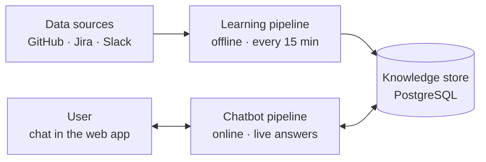
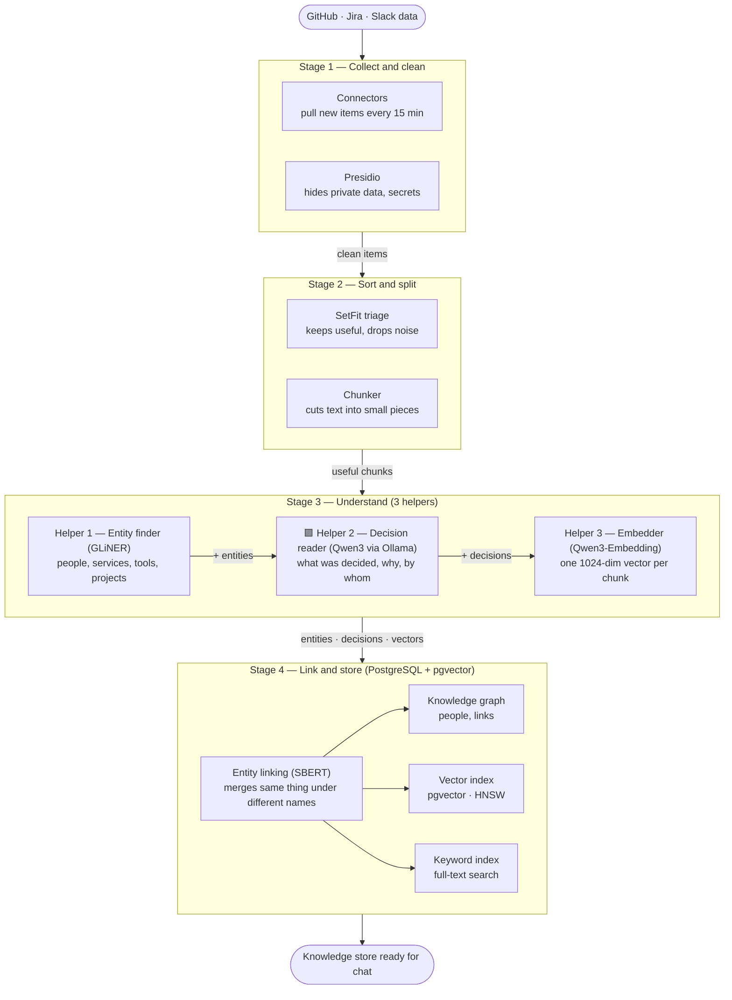
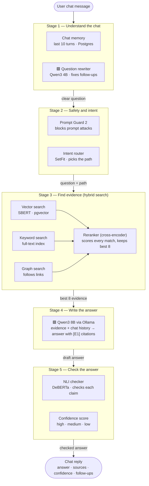

# Syncra — Project Description

> **Syncra is a team-memory chatbot.** It learns from a team's **GitHub, Jira and Slack** — who built what, what was decided, why, and by whom — and answers questions about it in a web chat, with **cited sources**, a **confidence score**, and **every AI model running locally**.

This document describes **what Syncra must do and what it is built with**. It is the reference for anyone (human or LLM) working on the project.

---

## 1. The problem

Engineering knowledge is scattered across tools. A decision is discussed in a Slack thread, tracked in a Jira ticket and implemented in a GitHub PR. Months later nobody remembers *why* the payment service uses a queue or *who* owns the auth module, and searching three tools by hand is slow and unreliable.

## 2. The solution

Syncra continuously reads those three tools, turns the raw activity into structured knowledge (people, services, projects, decisions and how they connect), and lets anyone on the team ask questions in plain language:

- "Who built the payment service?"
- "Why did we move billing from REST to gRPC?"
- "What did we decide about retry limits last sprint?"
- "Which PRs touched the auth module this month?"
- *(follow-up)* "Who reviewed it?"

Every answer shows **where it came from**, **how confident** Syncra is, and **suggested follow-up questions**.

---

## 3. Core principles

**Local-first.** All LLMs run on **Ollama**, and all small models run via **Hugging Face** (`sentence-transformers`). Company data never leaves the machine.

**One database.** Everything (graph, vectors, keyword index, decisions, chat history) lives in **PostgreSQL** with **pgvector**. There is no separate vector DB, search engine or graph DB.

**Small models first, LLM last.** Fast, cheap models (SetFit, GLiNER, SBERT, cross-encoder, DeBERTa) do most of the work. The LLM is used only where reasoning is needed: reading decisions, rewriting follow-ups and writing answers.

**Privacy by default.** Personal data and secrets are hidden **before** anything is stored. Search only covers what the asking user is allowed to see.

**Grounded answers.** Answers are written only from retrieved evidence and cite it (`[E1]`, `[E2]` …). Claims the evidence doesn't support are removed.

**Safe actions.** If a user asks Syncra to *do* something, it shows an **approval card** first. Nothing runs without the user's approval.

---

## 4. System overview

Syncra has **two pipelines** that share **one knowledge store**.



**Learning pipeline.** Runs offline, in the background, every 15 minutes. It turns raw GitHub / Jira / Slack data into structured, searchable knowledge.

**Knowledge store.** Always on (PostgreSQL). It holds the knowledge graph, vector index, keyword index, decisions and chat history.

**Chatbot pipeline.** Runs online, once per chat message. It turns a user's question into a checked, cited answer.

**Diagram colour legend:** 🟪 Purple = LLM (Qwen3 via Ollama) · 🟩 Teal = small AI models, tools and search

---

## 5. Part 1 — Learning pipeline (offline, every 15 min)



### Stage 1 — Collect and clean

**Connectors** (GitHub, Jira and Slack APIs). Every 15 minutes, pull only **new or changed** items: PRs, commits, reviews, issues, comments, Slack messages and threads. Keep each item's link, author, time and access permissions.

**Privacy scrubber** (**Microsoft Presidio**). Find and hide personal data (emails, phone numbers, etc.) and secrets (API keys, tokens, passwords) **before** anything is stored.

**Output →** clean items.

### Stage 2 — Sort and split

**Triage** (**SetFit** classifier). Keep useful items and drop noise: bot messages, "thanks!", emoji-only replies, CI chatter.

**Chunker** (text splitter). Cut long text into small, slightly overlapping pieces that fit the embedder and the LLM. Each chunk remembers its source item.

**Output →** useful chunks.

### Stage 3 — Understand (3 helpers, in order)

1. **Entity finder** (**GLiNER**): chunk → names + types (`person`, `service`, `tool`, `project`).
2. **Decision reader** 🟪 (**Qwen3 via Ollama**): thread / PR + entities → what was decided, why, by whom.
3. **Embedder** (**Qwen3-Embedding** via Hugging Face `sentence-transformers`): chunk → one **1024-dimension** vector.

The decision reader must return strict JSON:

```json
{
  "decision": "Put a message queue between checkout and the payment service",
  "reason": "The payment provider times out under load; the queue absorbs spikes",
  "people": ["alice", "bob"]
}
```

Output that isn't valid JSON is retried or dropped — never stored half-parsed.

**Output →** entities, decisions, vectors.

### Stage 4 — Link and store (PostgreSQL + pgvector)

**Entity linking** (**SBERT** similarity). Merge the same thing written different ways (`payments-svc`, `payment service`, `PaymentService` → one entity).

**Knowledge graph** (PostgreSQL tables). Store people, services, tools, projects, decisions and the links between them (authored, reviewed, decided, mentions, owns, depends on).

**Vector index** (**pgvector** with an **HNSW** index). Fast meaning-based search over chunk vectors.

**Keyword index** (PostgreSQL **full-text search**). Exact-term search: ticket IDs, function names, error codes.

**Output →** knowledge store ready for chat.

---

## 6. Part 2 — Chatbot pipeline (online, live answers)



### Stage 1 — Understand the chat

**Chat memory** (PostgreSQL). Load the last **10 turns** of the conversation.

**Question rewriter** 🟪 (**Qwen3 4B via Ollama**). Turn a follow-up into a standalone question: `"who built it?"` → `"who built the payment service?"`.

### Stage 2 — Safety and intent

**Prompt guard** (**Meta Prompt Guard 2**). Detect and block prompt-injection / jailbreak attempts.

**Intent router** (**SetFit** classifier). Decide which path the message takes:

- **Small talk** ("hi", "thanks"): an instant reply, with no search and no LLM.
- **Question**: the full pipeline (Stages 3 → 5).
- **Action** ("create a Jira ticket for this"): show an **approval card**. It runs only after the user approves.

### Stage 3 — Find evidence (hybrid search)

Three searches run **in parallel**, and each **only searches what this user is allowed to see** (permissions are applied inside the search, not afterwards).

- **Vector search** (SBERT question vector → pgvector) is good at meaning: "why is checkout slow?"
- **Keyword search** (PostgreSQL full-text index) is good at exact terms: `PAY-1234`, `retry_limit`.
- **Graph search** (follows links in the knowledge graph) is good at relationships: "who reviewed X?", "what depends on Y?"

All matches go to a **reranker** — a **cross-encoder** from Hugging Face `sentence-transformers` — which scores every match against the question and **keeps the best 8**.

### Stage 4 — Write the answer

**Answer writer** 🟪 (**Qwen3 8B via Ollama**). Read the 8 evidence items + chat history and write the answer with inline citations `[E1]…[E8]`. It **streams word by word.**

Rules:
- Answer **only** from the evidence. If the evidence isn't enough, say "I don't know" rather than guess.
- Every factual claim must carry at least one citation.

### Stage 5 — Check the answer

**Claim checker** (**DeBERTa** NLI model). Check each claim against the evidence it cites. **Unsupported claims are removed.**

**Confidence score** (based on the checker and reranker scores). Label the answer **high**, **medium** or **low**.

### Chat reply

The user receives **answer · sources (clickable links) · confidence · suggested follow-ups**. The turn is **saved to chat history**.

---

## 7. What gets stored (knowledge store)

All in **PostgreSQL**.

**Knowledge graph**: entities (people, services, tools, projects, decisions) and the links between them. Used by graph search.

**Vector index**: one 1024-dim vector per chunk (pgvector, HNSW). Used by vector search.

**Keyword index**: a full-text index over chunk text. Used by keyword search.

**Decisions**: `{decision, reason, people}` plus the source link and date. Used by graph search and answers.

**Chunks & sources**: chunk text, source link, author, time and permissions. Used for evidence and citations.

**Chat history**: every user message and reply, with sources and confidence. Used by chat memory (last 10 turns).

---

## 8. Model & tool list

**Learning pipeline**

- Hide personal data & secrets: **Presidio** (Python library)
- Useful vs. noise: **SetFit** (Hugging Face)
- Find entities: **GLiNER** (Hugging Face)
- Read decisions 🟪: **Qwen3** (Ollama)
- Merge duplicate entities: **SBERT** (sentence-transformers)

**Chatbot pipeline**

- Rewrite follow-ups 🟪: **Qwen3 4B** (Ollama)
- Block prompt attacks: **Prompt Guard 2** (Hugging Face)
- Pick the path: **SetFit** (Hugging Face)
- Rank evidence: **Cross-encoder** (sentence-transformers)
- Write the answer 🟪: **Qwen3 8B** (Ollama)
- Check claims: **DeBERTa** NLI (Hugging Face)

**Both pipelines**

- Make vectors (1024-dim): **Qwen3-Embedding** (sentence-transformers)
- Store everything: **PostgreSQL + pgvector** (database)

---

## 9. Key numbers

- Sync interval: every **15 minutes**
- Embedding size: **1024** dimensions
- Vector index type: **HNSW**
- Chat memory: last **10 turns**
- Evidence passed to the answer writer: best **8**
- Confidence levels: **high / medium / low**

---

## 10. Example walkthrough

**Learning (background):** Alice opens a PR *"Add queue between checkout and payments"*, and the team discusses it in Slack.

1. Connectors pull the PR and the Slack thread; Presidio hides an API key pasted in the thread.
2. SetFit keeps the discussion and drops a bot's "build passed" message; the chunker splits the thread.
3. GLiNER finds `alice` (person), `payment service` (service), `RabbitMQ` (tool). Qwen3 reads the thread and writes `{decision: "add a queue", reason: "provider timeouts under load", people: ["alice", "bob"]}`. Each chunk gets a vector.
4. SBERT links `payments-svc` and `payment service` as one entity; the graph, vector index and keyword index are updated.

**Chat (live):**

1. User: *"Why did we add a queue to payments?"* → intent = question → hybrid search → best 8 → Qwen3 8B answers: *"Because the payment provider was timing out under load [E1]. Alice proposed it and Bob approved it [E2]."* → DeBERTa confirms both claims → confidence **high**.
2. User: *"Who built it?"* → rewriter turns it into *"Who built the payment queue?"* → answered the same way.
3. User: *"Open a Jira ticket to add monitoring for it."* → intent = action → **approval card** shown.

---

## 11. Out of scope (for now)

- Hosted / cloud LLM APIs — everything runs locally.
- Data sources other than GitHub, Jira and Slack.
- Actions that run without user approval.
