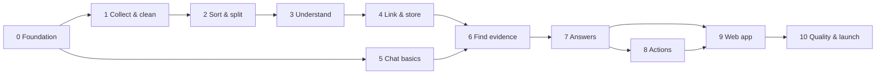

# Syncra — Build Phases

This file splits the whole Syncra build (see [`description.md`](description.md)) into **phases** and **small tasks**. Each task is sized to be handed to **Claude Code** in one session.

---

## How to use this file

1. Do phases **in order**. Inside a phase, follow each task's **Depends on** line.
2. Give Claude Code **one task at a time** with this prompt:

   ```
   Read agent.md, then progress.md, description.md and phases.md.
   Do Task <ID> only. Follow its "Build" and "Done when" lists exactly.
   Don't start other tasks. When finished, run the tests, log the task in
   progress.md, tick it in phases.md, and summarise what you built.
   ```

3. Check the **Done when** list yourself before moving on.
4. Commit after every task, e.g. `git commit -m "Task 1.2: GitHub connector"`.

**Rules for every task**
- Keep to the architecture in `description.md`. Don't swap tools without asking.
- Everything runs locally: LLMs on **Ollama**, small models from **Hugging Face**, data in **PostgreSQL + pgvector**.
- Put model names, numbers (15 min, top 8, 10 turns, 1024 dims) and labels in **config**, not in code.
- Every task leaves **tests** behind (they must pass) and updates the README if setup changed.
- Unit tests use **fake / mocked** GitHub, Jira, Slack and Ollama — no real API keys in tests.

---

## Phase overview

| Phase | Name | Result at the end |
|---|---|---|
| 0 | Foundation | Project runs locally: database, Ollama, config, model access, tests |
| 1 | Collect and clean | GitHub, Jira, Slack data pulled every 15 min with private data hidden |
| 2 | Sort and split | Noise dropped, useful text cut into chunks |
| 3 | Understand | Entities, decisions and vectors produced for each chunk |
| 4 | Link and store | Full learning pipeline fills the knowledge store automatically |
| 5 | Chat basics | Chat API with memory, follow-up rewriting, safety and intent routing |
| 6 | Find evidence | Hybrid search (vector + keyword + graph) with permissions and reranking |
| 7 | Write and check answers | Streamed, cited, fact-checked answers with confidence |
| 8 | Actions | Approval cards for "do something" requests (e.g. create a Jira ticket) |
| 9 | Web app | Chat UI for users, plus source connection screens |
| 10 | Quality and launch | Evaluation, permission tests, speed tuning, demo data, docs |



> Phases 1–4 (learning) and Phase 5 (chat basics) can be built in parallel once Phase 0 is done.

---

## Phase 0 — Foundation

**Goal:** a working local project skeleton that every later task builds on.

### Task 0.1 — Project skeleton
**Depends on:** nothing
**Build**
- Python backend project (Python 3.11+, dependency file, linter, formatter, test runner).
- A web API framework with a `GET /health` endpoint.
- Folder layout for: API, learning pipeline, chatbot pipeline, models, database, background jobs, config, tests.
- A `README.md` with setup and run commands.

**Done when**
- One command installs dependencies, one starts the API, one runs tests.
- `GET /health` returns `{"status": "ok"}` and a test covers it.

### Task 0.2 — Local services with Docker
**Depends on:** 0.1
**Build**
- `docker-compose.yml` with **PostgreSQL + pgvector** and **Ollama**.
- A script that pulls the Ollama models: **Qwen3 4B**, **Qwen3 8B**.
- `.env.example` listing every setting.

**Done when**
- `docker compose up` starts both services.
- The `vector` extension is enabled in Postgres.
- `ollama list` shows both Qwen3 models.

### Task 0.3 — Configuration
**Depends on:** 0.1
**Build**
- One settings module loading from `.env` + config files.
- A model config file listing every model from `description.md` §8 (name, version, runtime).
- Constants as settings: sync interval 15 min, chat memory 10 turns, top-k 8, embedding size 1024.

**Done when**
- Changing a value in config changes app behaviour without code edits.
- Missing required settings fail at startup with a clear message.

### Task 0.4 — Database schema and migrations
**Depends on:** 0.2, 0.3
**Build** (with a migration tool) tables for:
- `users` and `user_source_identities` (maps a Syncra user to their GitHub / Jira / Slack accounts).
- `sources` (connected GitHub repos, Jira projects, Slack channels) and `sync_cursors`.
- `items` (raw cleaned items: type, source, link, author, time, text, permissions).
- `chunks` (text, item link, `vector(1024)`, full-text `tsvector`).
- `entities`, `entity_aliases`, `edges` (knowledge graph).
- `decisions` (`decision`, `reason`, `people`, source link, date).
- `chat_sessions`, `chat_messages` (with sources and confidence).
- `actions` (pending / approved / rejected / done).
- **HNSW** index on `chunks.vector`, **GIN** index on `chunks.tsvector`.

**Done when**
- Migrations run up and down cleanly on an empty database.
- A test inserts and reads one row in every table.

### Task 0.5 — Model gateway
**Depends on:** 0.3
**Build** a single place every model call goes through:
- **Ollama client**: generate (normal + streaming), JSON mode, timeout, retry.
- **Hugging Face loader**: loads a model once, caches it in memory, runs on CPU or GPU if available.
- A script that downloads all Hugging Face models ahead of time.
- Logging of model name, time taken and token count for each call.

**Done when**
- A test calls a mocked Ollama and a tiny HF model through the gateway.
- Running the download script fetches every HF model in config.

### Task 0.6 — Background job runner
**Depends on:** 0.1, 0.2
**Build**
- A background job system with a scheduler (e.g. Celery + beat, or similar).
- A dummy job that runs every 15 minutes (interval read from config).

**Done when**
- Starting the worker runs the dummy job on schedule and logs it.

---

## Phase 1 — Collect and clean (Learning Stage 1)

**Goal:** new GitHub, Jira and Slack items arrive every 15 minutes, with private data hidden.

### Task 1.1 — Connector interface
**Depends on:** 0.4
**Build**
- A shared connector interface: `fetch_new(since_cursor) -> items, next_cursor`.
- One common **item format**: id, source, type (pr, commit, review, issue, comment, message, thread), title, text, author, time, link, parent/thread id, **who can see it**.
- Saving items + updating the cursor in one transaction.

**Done when**
- A fake connector's items are saved and the cursor moves forward; re-running fetches nothing new.

### Task 1.2 — GitHub connector
**Depends on:** 1.1
**Build** pull PRs, PR descriptions, review comments, commits and issues for configured repos, incrementally. Record repo visibility as permissions.
**Done when** tests with recorded/mocked GitHub responses produce correct items and handle paging + rate limits.

### Task 1.3 — Jira connector
**Depends on:** 1.1
**Build** pull issues, descriptions and comments for configured projects, incrementally. Record project access as permissions.
**Done when** tests with mocked Jira responses produce correct items and handle paging.

### Task 1.4 — Slack connector
**Depends on:** 1.1
**Build** pull messages and **whole threads** from configured channels, incrementally. Record channel membership as permissions. Skip DMs.
**Done when** tests with mocked Slack responses produce one item per thread, with replies kept in order.

### Task 1.5 — Privacy scrubber (Presidio)
**Depends on:** 1.1, 0.5
**Build**
- Use **Microsoft Presidio** to hide personal data (emails, phone numbers, etc.).
- Add secret detectors: API keys, tokens, passwords, private keys, connection strings.
- Run it on every item **before** saving.

**Done when** tests show emails, phone numbers and fake AWS / GitHub / Slack tokens are masked, and normal code names are not.

### Task 1.6 — Scheduled sync job
**Depends on:** 0.6, 1.2, 1.3, 1.4, 1.5
**Build** a job that, every 15 minutes, runs each connected source → scrubber → saves items, and then queues them for Phase 2. One failing source must not stop the others. Also drop exact duplicate items.
**Done when** running the job twice in a row only stores new items, and a failing connector is logged and skipped.

---

## Phase 2 — Sort and split (Learning Stage 2)

**Goal:** only useful items continue, cut into small chunks.

### Task 2.1 — Triage training data
**Depends on:** 1.1
**Build** a labelled set (≈ 100–300 examples) of **useful** vs **noise** items (bot messages, "thanks!", emoji-only, CI chatter, "+1"). Store labels in config.
**Done when** the dataset file exists with both labels well represented.

### Task 2.2 — SetFit triage model
**Depends on:** 2.1, 0.5
**Build** train a **SetFit** classifier on the triage data, save it, and add a `triage(item) -> useful | noise` step. Add a simple rule pre-filter for obvious noise (bot authors, empty text).
**Done when** accuracy on a held-out split is reported and is ≥ 90%; noise items are marked and skipped.

### Task 2.3 — Chunker
**Depends on:** 1.1
**Build** cut item text into small, slightly overlapping chunks sized for the embedder. Keep code blocks and short Slack messages whole. Each chunk keeps its item id, link, author, time and permissions.
**Done when** tests cover long text, code blocks, very short text and a Slack thread.

---

## Phase 3 — Understand (Learning Stage 3)

**Goal:** each chunk has entities, decisions (where present) and a vector.

### Task 3.1 — Entity finder (GLiNER)
**Depends on:** 2.3, 0.5
**Build** run **GLiNER** on each chunk with labels `person`, `service`, `tool`, `project` (labels in config). Return names + types + confidence; drop low-confidence hits.
**Done when** tests on sample PR / Slack text find the expected entities.

### Task 3.2 — Decision reader prompt
**Depends on:** 0.5
**Build** a versioned prompt for **Qwen3 via Ollama** that reads a thread or PR (+ its entities) and returns JSON `{decision, reason, people}`, or an empty result when nothing was decided. Include 2–3 examples in the prompt.
**Done when** the prompt file exists and is loaded from config.

### Task 3.3 — Decision reader step
**Depends on:** 3.1, 3.2
**Build**
- Run the decision reader on **whole threads / PRs** (not single chunks).
- Validate the JSON against a schema; retry once on bad output, then drop it.
- Only run it on items likely to contain decisions (skip short ones) to save time.

**Done when** tests with mocked Ollama cover: good JSON, bad JSON then good, bad twice (dropped), and "no decision".

### Task 3.4 — Embedder
**Depends on:** 2.3, 0.5
**Build** turn each chunk into a **1024-dim** vector with **Qwen3-Embedding** via `sentence-transformers`, in batches.
**Done when** vectors are 1024 long, normalised, and similar sentences score higher than unrelated ones in a test.

---

## Phase 4 — Link and store (Learning Stage 4)

**Goal:** the learning pipeline runs end to end and the knowledge store is ready for chat.

### Task 4.1 — Entity linking (SBERT)
**Depends on:** 3.1, 0.4
**Build** merge entities that are the same thing under different names (`payments-svc`, `payment service`, `PaymentService`) using **SBERT** similarity + simple name normalisation. Keep all names as aliases of one entity. Link Slack / GitHub / Jira people to the same person where possible.
**Done when** tests show those three names become one entity, and two different services stay separate.

### Task 4.2 — Knowledge graph writer
**Depends on:** 4.1, 3.3
**Build** save entities, decisions and links: person **authored** PR, person **reviewed** PR, chunk **mentions** entity, person **decided** decision, decision **about** service, and so on. Re-running must not create duplicates.
**Done when** after processing a sample PR + Slack thread, the expected nodes and links exist exactly once.

### Task 4.3 — Search indexes
**Depends on:** 3.4, 0.4
**Build** save chunk vectors into the **pgvector HNSW** index and chunk text into the **full-text** index.
**Done when** a raw SQL vector query and a raw full-text query each return the right chunk in a test.

### Task 4.4 — Learning pipeline orchestration
**Depends on:** 1.6, 2.2, 2.3, 3.1, 3.3, 3.4, 4.1, 4.2, 4.3
**Build** connect everything: sync → scrub → triage → chunk → entities → decisions → embed → link → store, run by the 15-minute job. Process in batches; a failure on one item must not stop the batch; failed items can be retried.
**Done when** with mocked sources, one run fills every store, and a second run with no new data changes nothing.

---

## Phase 5 — Chat basics (Chatbot Stages 1–2)

**Goal:** a chat API that remembers context, cleans up follow-ups, blocks attacks and picks a path.

### Task 5.1 — Users and login
**Depends on:** 0.4
**Build** simple user accounts + login (token based). Each request knows which user is asking. Users can link their GitHub / Jira / Slack identities.
**Done when** protected endpoints reject requests without a valid token.

### Task 5.2 — Chat sessions and memory
**Depends on:** 5.1
**Build** create / list chat sessions, save every message, load the **last 10 turns** for a session.
**Done when** tests show the 11th-oldest turn is not loaded.

### Task 5.3 — Question rewriter
**Depends on:** 5.2, 0.5
**Build** use **Qwen3 4B via Ollama** with the chat history to turn follow-ups into standalone questions (`"who built it?"` → `"who built the payment service?"`). Skip the LLM call when there is no history.
**Done when** tests with mocked Ollama cover a follow-up and a first message.

### Task 5.4 — Prompt guard
**Depends on:** 0.5
**Build** run **Meta Prompt Guard 2** on every message; block attacks with a polite reply.
**Done when** known injection examples are blocked and normal questions pass.

### Task 5.5 — Intent router (SetFit)
**Depends on:** 0.5
**Build** labelled examples and a **SetFit** classifier for `small_talk`, `question`, `action`. Small talk gets an instant reply without search or LLM.
**Done when** held-out accuracy ≥ 90% and "hi" / "thanks" get an instant reply.

### Task 5.6 — Chat endpoint (skeleton)
**Depends on:** 5.2, 5.3, 5.4, 5.5
**Build** `POST` chat endpoint: memory → rewrite → guard → intent → (small talk reply | placeholder for question | placeholder for action). Save each turn.
**Done when** an end-to-end test sends three messages and gets the right path for each.

---

## Phase 6 — Find evidence (Chatbot Stage 3)

**Goal:** given a clear question, return the best 8 pieces of evidence the user is allowed to see.

### Task 6.1 — Permission filter
**Depends on:** 5.1, 4.4
**Build** a reusable filter that limits any search to items the user may see (based on their linked identities and each item's permissions). It must be applied **inside** the database query.
**Done when** tests show a user without access to a private repo / channel never gets its chunks.

### Task 6.2 — Vector search
**Depends on:** 6.1, 3.4
**Build** embed the question with the same embedder, search pgvector (HNSW) with the permission filter, return top N chunks with scores.
**Done when** a meaning-based test question finds the right chunk.

### Task 6.3 — Keyword search
**Depends on:** 6.1
**Build** PostgreSQL full-text search with the permission filter, good at IDs (`PAY-1234`), function names and error codes.
**Done when** exact-term test questions find the right chunk.

### Task 6.4 — Graph search
**Depends on:** 6.1, 4.2
**Build** find entities named in the question (GLiNER + alias lookup), then follow links (authored, reviewed, decided, mentions, depends on) 1–2 steps to collect related decisions and chunks, with the permission filter.
**Done when** "who reviewed the payment queue PR?" returns the review evidence.

### Task 6.5 — Merge and rerank
**Depends on:** 6.2, 6.3, 6.4
**Build** run the three searches **in parallel**, merge and de-duplicate results, score each with a **cross-encoder** (`sentence-transformers`), keep the **best 8**. Label them `E1…E8`.
**Done when** the right chunk ranks in the top 8 on test questions, and results never include duplicates.

---

## Phase 7 — Write and check answers (Chatbot Stages 4–5)

**Goal:** a streamed, cited, checked answer with confidence and follow-ups.

### Task 7.1 — Answer writer prompt
**Depends on:** 0.5
**Build** a versioned prompt for **Qwen3 8B**: answer **only** from evidence, cite every claim with `[E#]`, say "I don't know" when evidence is missing, suggest 2–3 follow-up questions.
**Done when** the prompt file exists and is loaded from config.

### Task 7.2 — Answer writer step (streaming)
**Depends on:** 7.1, 6.5
**Build** send evidence + chat history + question to **Qwen3 8B via Ollama** and **stream** the answer word by word.
**Done when** a test with mocked streaming Ollama receives the answer in pieces and the full text contains citations.

### Task 7.3 — Claim checker (DeBERTa NLI)
**Depends on:** 7.2
**Build** split the answer into claims, check each against its cited evidence with a **DeBERTa** NLI model, and **remove unsupported claims**.
**Done when** a test answer with one made-up claim comes back with that claim removed.

### Task 7.4 — Confidence score
**Depends on:** 7.3
**Build** combine claim-check and reranker scores into **high / medium / low** (thresholds in config).
**Done when** tests cover all three levels.

### Task 7.5 — Full chat reply
**Depends on:** 7.4, 5.6
**Build** plug Phases 6–7 into the chat endpoint's `question` path. Reply = **answer · sources (links) · confidence · follow-ups**. Stream to the client (e.g. Server-Sent Events) and send the checked version at the end. Save to chat history.
**Done when** an end-to-end test (mocked models) asks a question and a follow-up and gets cited, checked replies.

---

## Phase 8 — Actions

**Goal:** Syncra can propose actions, but only runs them after the user approves.

### Task 8.1 — Action planner
**Depends on:** 5.6, 0.5
**Build** for `action` intent, use Qwen3 to turn the request into a structured action (start with **create Jira ticket**: project, title, description). Save it as `pending` and return an **approval card**.
**Done when** "open a Jira ticket to add monitoring for payments" returns a filled approval card and nothing is created yet.

### Task 8.2 — Approve / reject and run
**Depends on:** 8.1
**Build** endpoints to approve or reject a pending action. On approve, run it with the user's own permissions and record the result. Log every action.
**Done when** approve creates the ticket (mocked Jira), reject does nothing, and both are logged.

---

## Phase 9 — Web app

**Goal:** a clean chat web app for users.

### Task 9.1 — Web app skeleton and login
**Depends on:** 5.1
**Build** a web app (e.g. React / Next.js) with login and a layout: chat list on the left, chat on the right.
**Done when** a user can log in and see an empty chat.

### Task 9.2 — Chat screen
**Depends on:** 9.1, 7.5
**Build** send messages, show streamed answers word by word, clickable `[E#]` citations, a sources list, a confidence badge (high / medium / low) and follow-up buttons. Chat history persists.
**Done when** a full conversation works against the real backend.

### Task 9.3 — Approval cards
**Depends on:** 9.2, 8.2
**Build** show action cards with Approve / Reject buttons and the result.
**Done when** approving from the UI creates the ticket (mocked or test Jira).

### Task 9.4 — Sources and settings screens
**Depends on:** 9.1, 1.6
**Build** screens to connect GitHub / Jira / Slack, choose repos / projects / channels, see last sync time and errors, and link the user's own accounts.
**Done when** an admin can add a source and see it sync.

---

## Phase 10 — Quality and launch

**Goal:** prove it works, keep it safe, make it fast, make it easy to demo.

### Task 10.1 — Demo data
**Depends on:** 4.4
**Build** a script that loads a realistic fake company (repos, tickets, Slack threads, decisions) so Syncra can be demoed without real accounts.
**Done when** one command loads the data and the chat answers demo questions.

### Task 10.2 — Evaluation set and runner
**Depends on:** 7.5, 10.1
**Build** 50+ question / expected-answer / expected-source examples on the demo data, and a runner that measures: right source in top 8, citation correctness, unsupported-claim rate, "I don't know" when it should.
**Done when** the runner prints a score report and can be re-run after changes.

### Task 10.3 — Permission and safety tests
**Depends on:** 6.1, 5.4, 1.5
**Build** tests that try to leak private data: users without access, prompt injection inside Slack messages, secrets in source text.
**Done when** all leak tests pass.

### Task 10.4 — Speed tuning
**Depends on:** 7.5
**Build** measure time per chatbot stage; target first word in **< 3 s** on a normal laptop. Cache models in memory, tune HNSW, keep small-talk replies instant.
**Done when** a timing report exists and the target is met or the gap is explained.

### Task 10.5 — Monitoring and logs
**Depends on:** 4.4, 7.5
**Build** structured logs, per-stage timings, sync status, model errors, and an admin view of recent failures.
**Done when** a failed sync and a slow answer are both visible to an admin.

### Task 10.6 — Final docs
**Depends on:** all
**Build** update `README.md` (setup, run, demo), keep `description.md` in sync with what was built, add a short troubleshooting guide.
**Done when** a new developer can go from clone to working demo using only the README.

---

## Progress checklist

**Phase 0 — Foundation**
- [x] 0.1 Project skeleton
- [x] 0.2 Local services with Docker
- [x] 0.3 Configuration
- [x] 0.4 Database schema and migrations
- [x] 0.5 Model gateway
- [x] 0.6 Background job runner

**Phase 1 — Collect and clean**
- [x] 1.1 Connector interface
- [x] 1.2 GitHub connector
- [x] 1.3 Jira connector
- [ ] 1.4 Slack connector
- [ ] 1.5 Privacy scrubber (Presidio)
- [ ] 1.6 Scheduled sync job

**Phase 2 — Sort and split**
- [ ] 2.1 Triage training data
- [ ] 2.2 SetFit triage model
- [ ] 2.3 Chunker

**Phase 3 — Understand**
- [ ] 3.1 Entity finder (GLiNER)
- [ ] 3.2 Decision reader prompt
- [ ] 3.3 Decision reader step
- [ ] 3.4 Embedder

**Phase 4 — Link and store**
- [ ] 4.1 Entity linking (SBERT)
- [ ] 4.2 Knowledge graph writer
- [ ] 4.3 Search indexes
- [ ] 4.4 Learning pipeline orchestration

**Phase 5 — Chat basics**
- [ ] 5.1 Users and login
- [ ] 5.2 Chat sessions and memory
- [ ] 5.3 Question rewriter
- [ ] 5.4 Prompt guard
- [ ] 5.5 Intent router (SetFit)
- [ ] 5.6 Chat endpoint (skeleton)

**Phase 6 — Find evidence**
- [ ] 6.1 Permission filter
- [ ] 6.2 Vector search
- [ ] 6.3 Keyword search
- [ ] 6.4 Graph search
- [ ] 6.5 Merge and rerank

**Phase 7 — Write and check answers**
- [ ] 7.1 Answer writer prompt
- [ ] 7.2 Answer writer step (streaming)
- [ ] 7.3 Claim checker (DeBERTa NLI)
- [ ] 7.4 Confidence score
- [ ] 7.5 Full chat reply

**Phase 8 — Actions**
- [ ] 8.1 Action planner
- [ ] 8.2 Approve / reject and run

**Phase 9 — Web app**
- [ ] 9.1 Web app skeleton and login
- [ ] 9.2 Chat screen
- [ ] 9.3 Approval cards
- [ ] 9.4 Sources and settings screens

**Phase 10 — Quality and launch**
- [ ] 10.1 Demo data
- [ ] 10.2 Evaluation set and runner
- [ ] 10.3 Permission and safety tests
- [ ] 10.4 Speed tuning
- [ ] 10.5 Monitoring and logs
- [ ] 10.6 Final docs
